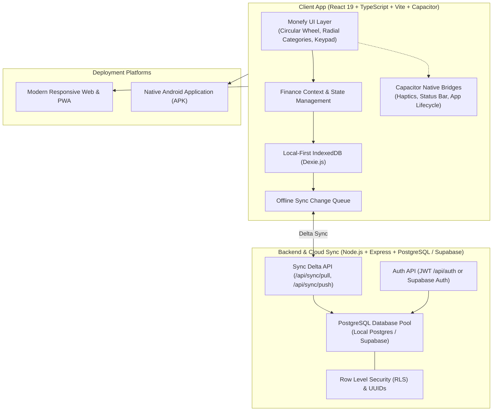

# AI Monefy: Personal Expense Tracker (Web & Android)
## Master Implementation Plan

AI Monefy is a high-performance, aesthetically refined personal finance tracker inspired by **Monefy**. It provides a single codebase supporting both **Web** (Desktop/Mobile PWA) and **Android** (via Capacitor native container), built with a **local-first architecture** with offline capability and seamless cloud synchronization backed by **PostgreSQL** (fully compatible with **Supabase**).

---

## 1. System Architecture



---

## 2. PostgreSQL & Supabase Compatibility Strategy

To ensure seamless transition to or direct use of **Supabase**:
1. **Schema Design**:
   - Primary keys use standard `UUID` (`gen_random_uuid()` or `uuid_generate_v4()`).
   - Timestamps use `TIMESTAMPTZ DEFAULT NOW()` for reliable multi-device delta synchronization.
   - Soft deletes via `is_deleted BOOLEAN DEFAULT FALSE`.
   - Foreign keys with `ON DELETE CASCADE` or `ON DELETE SET NULL`.
2. **Supabase Row-Level Security (RLS)**:
   - Provide standard SQL migration (`server/src/db/schema.sql`) with RLS enabled on all tables:
     ```sql
     ALTER TABLE transactions ENABLE ROW LEVEL SECURITY;
     CREATE POLICY "Users access own transactions" ON transactions
       FOR ALL USING (auth.uid() = user_id OR user_id = current_setting('app.current_user_id', true)::uuid);
     ```
3. **Dual Connection Support**:
   - Direct connection via standard PostgreSQL `DATABASE_URL` (supports local PostgreSQL or Supabase direct/pooled connection string).
   - Compatible with `@supabase/supabase-js` client SDK for direct client/server queries if desired.

---

## 3. Independent Phases & Tasks Breakdown

Each task is self-contained with well-defined inputs, outputs, and validation criteria.

### Phase 1: Project Scaffolding & Setup
- [ ] **Task 1.1: Root Monorepo Configuration**
  - **Goal**: Configure monorepo workspace for client and server.
  - **Deliverable**: `package.json` with scripts for `npm run dev`, `npm run build`, `npm run lint`.
  - **Verification**: `npm install` runs cleanly in root.

- [ ] **Task 1.2: Client Application Scaffold**
  - **Goal**: Set up React 19 + TypeScript + Vite client with dependencies (`dexie`, `lucide-react`, `canvas-confetti`).
  - **Deliverable**: `client/` folder with `vite.config.ts`, `tsconfig.json`, `index.html`.
  - **Verification**: `npm run build` in `client/` succeeds.

- [ ] **Task 1.3: Backend Server Scaffold (PostgreSQL / Supabase Ready)**
  - **Goal**: Set up Node.js + Express + TypeScript backend with PostgreSQL connection pooling (`pg`, `dotenv`).
  - **Deliverable**: `server/` folder with `package.json`, `tsconfig.json`, server bootstrap.
  - **Verification**: Server launches on specified port and responds to `/api/health`.

- [ ] **Task 1.4: Capacitor Android Integration**
  - **Goal**: Initialize Capacitor project and configure Android native platform.
  - **Deliverable**: `capacitor.config.ts`, native `client/android/` project scaffold.
  - **Verification**: `npx cap sync android` completes without errors.

---

### Phase 2: Design System & Core Shell
- [ ] **Task 2.1: Design System & Styling Engine**
  - **Goal**: Establish Monefy-inspired styling with dark (Obsidian Slate) and light themes, vibrant category colors, typography, and micro-animations.
  - **Deliverable**: `client/src/index.css` with CSS variables, component utility classes, responsive container rules.
  - **Verification**: Visual review of theme switcher and color tokens.

- [ ] **Task 2.2: Application Header & Time Interval Navigation**
  - **Goal**: Build top bar with interval tabs (`DAY`, `WEEK`, `MONTH`, `YEAR`, `ALL`, `INTERVAL`), navigation arrows (`<`, `>`), and date title.
  - **Deliverable**: `client/src/components/layout/Header.tsx`, interval calculation utilities in `utils/dateFilters.ts`.
  - **Verification**: Clicking `<` / `>` shifts current period; changing tabs re-filters timeframe.

- [ ] **Task 2.3: Layout Framework & Navigation Dock**
  - **Goal**: Create mobile-first app frame with top bar, main canvas, and bottom action bar / drawer trigger.
  - **Deliverable**: `client/src/components/layout/AppLayout.tsx`, `NavigationDrawer.tsx`.
  - **Verification**: Renders cleanly on both 375px mobile viewports and wide desktop displays.

---

### Phase 3: Data Layer & Local-First IndexedDB
- [ ] **Task 3.1: Data Models & Type Definitions**
  - **Goal**: Define robust TypeScript interfaces for `Transaction`, `Category`, `Account`, `Budget`, `SyncItem`.
  - **Deliverable**: `client/src/types/index.ts`.
  - **Verification**: Type-check validation with zero TypeScript errors.

- [ ] **Task 3.2: Dexie IndexedDB Store & Seed Data**
  - **Goal**: Initialize client database with default Monefy expense/income categories and accounts (Cash, Card, Savings).
  - **Deliverable**: `client/src/db/localDb.ts`.
  - **Verification**: IndexedDB opens in browser storage; default categories and accounts populate on first load.

- [ ] **Task 3.3: Finance Context & Reactive State**
  - **Goal**: Create React Context providing transactions, balances, account switching, and CRUD actions.
  - **Deliverable**: `client/src/context/FinanceContext.tsx`.
  - **Verification**: State updates reactively when records are added, edited, or deleted.

---

### Phase 4: Iconic Monefy Wheel & Keypad Experience
- [ ] **Task 4.1: Interactive Circular Donut Chart**
  - **Goal**: Custom SVG donut chart rendering dynamic category slices with hover/tap highlights and percentages.
  - **Deliverable**: `client/src/components/monefy-wheel/CircularChart.tsx`.
  - **Verification**: Chart updates dynamically when transactions change; slices represent category ratios.

- [ ] **Task 4.2: Center Balance Hub & Action Triggers**
  - **Goal**: Display net balance (Green = positive, Red = negative) in the wheel center, with `+` (Income), `-` (Expense), and `⇄` (Transfer) buttons.
  - **Deliverable**: `client/src/components/monefy-wheel/CenterBalance.tsx`.
  - **Verification**: Balance updates instantly; tapping `+` opens income keypad, tapping `-` opens expense keypad.

- [ ] **Task 4.3: Radial & Quick-Tap Category Grid**
  - **Goal**: Position category icons around the chart (mobile & desktop) showing total spent per category. Direct tap opens pre-selected entry.
  - **Deliverable**: `client/src/components/monefy-wheel/RadialCategoryGrid.tsx`.
  - **Verification**: Tapping any category (e.g. "Food") immediately launches keypad with "Food" pre-selected.

- [ ] **Task 4.4: Monefy Numeric Calculator Keypad**
  - **Goal**: Modal keypad with digits 0-9, inline arithmetic (`+`, `-`, `*`, `/`), note field, account selector, and date selector.
  - **Deliverable**: `client/src/components/keypad/NumericKeypadModal.tsx`.
  - **Verification**: Expressions like `15 + 4.50` evaluate to `19.50`; saving records transaction with selected metadata.

---

### Phase 5: Multi-Account Management, Transfers & History
- [ ] **Task 5.1: Transaction History Sheet**
  - **Goal**: Collapsible/expandable bottom sheet listing transactions grouped by date, with search, edit, and swipe-to-delete.
  - **Deliverable**: `client/src/components/transactions/TransactionList.tsx`, `TransactionItem.tsx`.
  - **Verification**: Search filters items in real time; transactions can be edited or deleted.

- [ ] **Task 5.2: Multi-Account Manager & Filter**
  - **Goal**: Manage Cash, Cards, and Savings accounts; display individual balances; filter dashboard by account.
  - **Deliverable**: `client/src/components/accounts/AccountManager.tsx`.
  - **Verification**: Selecting "Cash" filters dashboard to Cash-only transactions; selecting "All" displays unified total.

- [ ] **Task 5.3: Account Transfer Modal**
  - **Goal**: Enable direct transfers between accounts (e.g., Bank Card -> Cash) with optional notes and fees.
  - **Deliverable**: `client/src/components/transactions/TransferModal.tsx`.
  - **Verification**: Transfer of $100 decreases Card by $100 and increases Cash by $100 without affecting net income/expense.

---

### Phase 6: Budgets, Analytics & Settings
- [ ] **Task 6.1: Category Budget Limits & Visual Meters**
  - **Goal**: Set monthly budget limits per category with progress bars (Green <70%, Amber 70-90%, Red >100%).
  - **Deliverable**: `client/src/components/budgets/BudgetModal.tsx`.
  - **Verification**: Exceeding budget shows visual badge and remaining spend warning.

- [ ] **Task 6.2: Expense Analytics & Category Breakdown**
  - **Goal**: Dedicated breakdown view showing category rankings, percentages, and trend bars.
  - **Deliverable**: `client/src/components/analytics/ExpenseBreakdown.tsx`.
  - **Verification**: Displays sorted category list with accurate percentages and graphical bars.

- [ ] **Task 6.3: Category Customizer & Currency Selector**
  - **Goal**: Add/edit custom categories (icon & color pickers) and change default currency (USD, EUR, GBP, INR, JPY, etc.).
  - **Deliverable**: `client/src/components/settings/CategoryCustomizer.tsx`, `CurrencySelector.tsx`.
  - **Verification**: New categories immediately appear on the wheel/grid; currency symbol updates globally.

- [ ] **Task 6.4: Data Export & Import (CSV / JSON)**
  - **Goal**: Export transactions to CSV and full database backup to JSON; import/restore from JSON.
  - **Deliverable**: `client/src/utils/exportImport.ts`, `DataExportImport.tsx`.
  - **Verification**: Exported CSV matches transaction data; JSON restore repopulates database.

---

### Phase 7: Cloud Synchronization Engine (PostgreSQL / Supabase)
- [ ] **Task 7.1: PostgreSQL Schema & Supabase DDL**
  - **Goal**: Create PostgreSQL schema file (`schema.sql`) and database connection module with UUIDs, RLS policies, and indexes.
  - **Deliverable**: `server/src/db.ts`, `server/src/db/schema.sql`.
  - **Verification**: Schema executes cleanly in PostgreSQL or Supabase SQL Editor.

- [ ] **Task 7.2: Authentication Endpoints**
  - **Goal**: User registration, login, and JWT token issuance (compatible with Supabase auth token format).
  - **Deliverable**: `server/src/routes/authRoutes.ts`.
  - **Verification**: Successful registration/login returns valid JWT and user payload.

- [ ] **Task 7.3: Delta Sync API (PostgreSQL)**
  - **Goal**: Implement `POST /api/sync/pull` and `POST /api/sync/push` with timestamp-based conflict resolution and batch upsert in PostgreSQL.
  - **Deliverable**: `server/src/routes/syncRoutes.ts`.
  - **Verification**: Pushed records are saved to PostgreSQL; pulled changes return records modified since last sync.

- [ ] **Task 7.4: Client Sync Engine Integration**
  - **Goal**: Queue local changes in IndexedDB; trigger sync on network recovery or manual refresh; update local state.
  - **Deliverable**: `client/src/db/syncEngine.ts`, `SyncSettings.tsx`.
  - **Verification**: Changes made offline sync automatically when back online; sync indicator displays status.

---

### Phase 8: Android Capacitor Build & Final Verification
- [ ] **Task 8.1: Capacitor Android Bridge & Config**
  - **Goal**: Configure Android permissions, status bar coloring, splash screen, and responsive viewport.
  - **Deliverable**: `client/capacitor.config.ts`, `android/` project updates.
  - **Verification**: Web assets build and sync into native Android project via `npx cap sync android`.

- [ ] **Task 8.2: End-to-End System Testing**
  - **Goal**: Comprehensive verification across Web and Mobile viewport with subagent browser testing.
  - **Deliverable**: Automated test runs and browser test recordings.
  - **Verification**: Complete Monefy workflow tested (wheel interaction, keypad math, multi-account transfers, budgets, sync).
